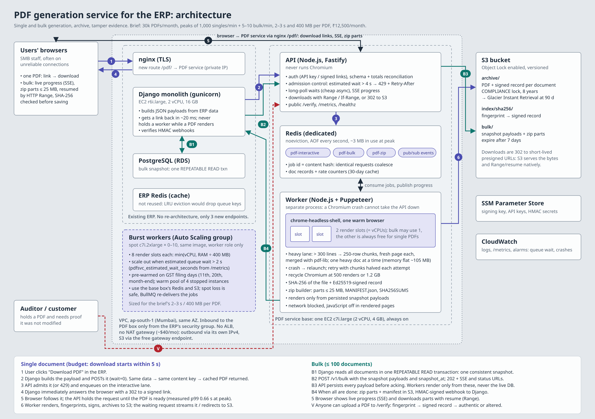

# ERP PDF Service

PDF generation microservice for an ERP: purchase orders and GST tax invoices,
one at a time or up to 100 per request, rendered with Puppeteer from HTML
templates.

**Start here:** [`APPROACH.md`](APPROACH.md) (design, capacity math, decisions, cost)
· [`architecture-diagram.png`](architecture-diagram.png) · [`docs/benchmarks.md`](docs/benchmarks.md) · [`docs/deployment.md`](docs/deployment.md)



## What it does

| Requirement from the brief | Where |
|---|---|
| Single + bulk (≤100) generation over HTTP/JSON | `POST /v1/documents`, `POST /v1/bulk` |
| Puppeteer + HTML templates | `src/render/` (Handlebars → `chrome-headless-shell`) |
| Download single file / zip for bulk | signed links; zip parts ≤ 25 MB with manifest |
| Concurrency, ~1,000 singles/min + 5–10 bulk/min at 2–3 s / 400 MB per PDF | always-on base box + spot burst workers scaled on estimated queue wait (APPROACH §3, `docs/deployment.md`); priority lanes; admission control. Load-tested on the base box alone: 100% of singles < 5 s at 1,000/min + 10 bulk/min |
| Bulk progress | Server-Sent Events + status URL + webhook |
| Compliance archive | S3 with Object Lock (COMPLIANCE, 8 years) |
| 500+ line POs crashing Puppeteer | heavy lane: chunked render + merge, adaptive retry, browser recycling. Chaos-tested |
| Unreliable connections | Range/If-Range resumable downloads, small zip parts, per-file downloads, SSE that resyncs |
| Stale data in bulk | one REPEATABLE READ snapshot in Django; service renders only persisted payloads |
| Tamper evidence | SHA-256 + Ed25519-signed record + Object Lock + public `/verify` + QR on every PDF |
| Budget ₹12,500/month | ≈ ₹10,915/month worst case at the brief's numbers; ≈ ₹7,246 if measured behaviour holds (APPROACH §8) |

## Run it locally

Needs Node ≥ 20 and Redis 7.

```bash
npm ci                                  # also downloads chrome-headless-shell
redis-server --maxmemory-policy noeviction &
npm run dev                             # API + worker → http://localhost:8080
```

Or with Docker:

```bash
cp .env.example .env
docker compose up --build               # → http://localhost:8080
```

> The Dockerfile and compose file have not been built/run in the environment
> this was developed in (no Docker daemon there). Everything else was run.

Open **http://localhost:8080** for the console: generate single documents
(including a 1,200-line PO), run a bulk batch and watch it print, download zip
parts with a simulated flaky connection, and check a PDF (or a one-byte-altered
copy) for tampering.

## API

All `POST`s from the ERP authenticate with `X-API-Key`. Everything a browser
fetches uses short-lived signed links returned by the API.

```bash
# One document. Waits up to 4 s for the render, then answers with links.
curl -s -X POST localhost:8080/v1/documents?wait=4000 \
  -H 'x-api-key: demo-key' -H 'content-type: application/json' \
  -d @docs/examples/invoice.json
# → 200 {status:"done", download_url, sha256, signature, pages, ...}
#   202 {status:"queued", download_url, status_url}  if not done yet
#   429 Retry-After                                    if estimated wait > 4 s
#   422 {problems:[...]}                               if totals don't reconcile

# Same, but get the PDF bytes directly
curl -s -X POST localhost:8080/v1/documents -H 'accept: application/pdf' ... -o invoice.pdf

# Bulk (≤100). Returns at once with progress URLs.
curl -s -X POST localhost:8080/v1/bulk -H 'x-api-key: demo-key' -H 'content-type: application/json' \
  -d '{"label":"October","snapshot_at":"2026-10-16T10:42:07Z","callback_url":"https://erp/hooks/pdf","documents":[ ... ]}'
# → 202 {bulk_id, status_url, events_url}
```

| Method & path | Auth | Purpose |
|---|---|---|
| `POST /v1/documents?wait=ms` | API key | Render one document (cached by content hash) |
| `GET /v1/documents/:key` | key or link | Status and record |
| `GET /v1/documents/:key/download?wait=ms&inline=1` | key or link | The PDF; waits if still rendering; Range supported |
| `POST /v1/bulk` | API key | Start a batch of ≤ 100 |
| `GET /v1/bulk/:id` | key or link | Progress, ETA, items, zip parts |
| `GET /v1/bulk/:id/events` | key or link | Server-Sent Events progress stream |
| `GET /v1/bulk/:id/parts/:n` | key or link | Zip part (Range supported) |
| `GET /v1/bulk/:id/items/:i` | key or link | One PDF from the batch |
| `POST /v1/bulk/:id/retry-failed` | API key | Re-run failed documents from the same snapshot |
| `POST /v1/verify` | public | Body: a PDF. → `authentic` / `modified` / `unknown` |
| `GET /v1/verify/:key`, `GET /verify` | public | Issued record; verification page (QR target) |
| `GET /v1/keys` | public | Ed25519 public key for offline verification |
| `GET /metrics`, `/healthz`, `/readyz`, `/v1/stats` | internal | Prometheus metrics, health, console stats |

Payload shape: see `src/lib/validate.js` (JSON Schema) and `src/lib/samples.js`
(generator used by tests and the console). Django-side code:
`integration/django/` (client, one-transaction snapshot builder, views, webhook
verification) and `integration/nginx-pdf-service.conf`.

## Tests and measurements

```bash
npm test                    # 18 tests: unit + end-to-end (real API, worker, Chromium, Redis db 15)
node scripts/smoke.js       # quick end-to-end against a running stack
node scripts/smoke-bulk.js  # 100-document bulk, SSE, zip, verify
node scripts/chaos.js       # SIGKILL Chromium mid-bulk; everything must still arrive
npm run bench               # renderer benchmark → docs/benchmark-results.json
node scripts/loadtest.js --rate 1000 --duration 60 --bulk-per-min 10 --tenants 5
```

The e2e tests need `pdftotext` and `unzip` on the PATH.

## Layout

```
src/
  api/          server.js (routes, auth, admission control), files.js (Range), events.js (pub/sub → SSE), stats.js
  queue/        queues.js (BullMQ queues, Redis records), worker.js (render, sign, archive, zip, webhook)
  render/       browserPool.js (Chromium lifecycle), renderer.js (single + chunked paths), templates/
  storage/      local + S3 (Object Lock) drivers
  lib/          crypto (hash, Ed25519, HMAC links), validation + reconciliation, Indian number words, samples
public/         console (index.html, app.js, download.js) and /verify page
integration/    Django client, snapshot builder, views, nginx snippet
scripts/        dev runner, benchmark, load test, chaos test, smoke tests, diagram renderer
assets/fonts/   pinned Noto Sans TTF (why: assets/fonts/README.md)
docs/           benchmarks.md + raw results
```

## Configuration

Every setting is an environment variable with a working default; see
[`.env.example`](.env.example). Production checklist:

- `DEMO_MODE=false`, real `API_KEYS`, `DOWNLOAD_TOKEN_SECRET`, `WEBHOOK_SECRET`
- `SIGNING_PRIVATE_KEY_PEM` from SSM Parameter Store (Ed25519, PKCS#8)
- `STORAGE_DRIVER=s3`, `S3_BUCKET` created **with Object Lock enabled**, lifecycle:
  `archive/` → Glacier Instant Retrieval after 90 days, `bulk/` expire after 7 days;
  bucket CORS must allow `Range`/`If-Range` and expose `Content-Range`, `ETag`
- `PUBLIC_BASE_URL=https://<erp-domain>/pdf` behind the nginx snippet
- EC2: IMDSv2 required, hop limit 1; security group inbound only from the ERP's SG
- Redis: `maxmemory-policy noeviction`, AOF on
